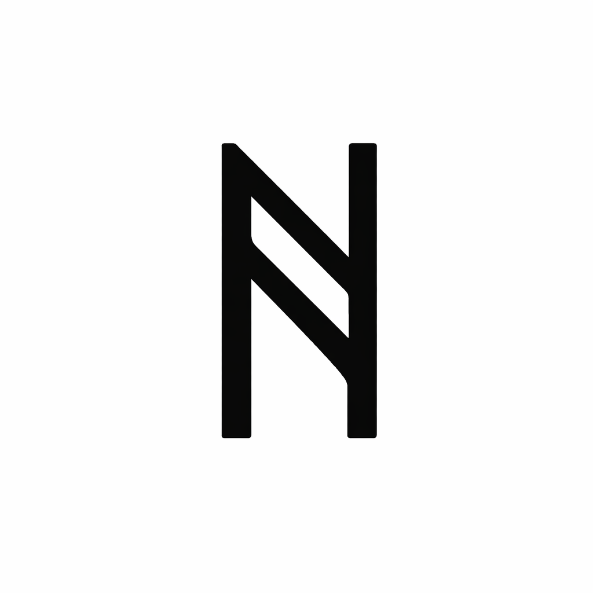
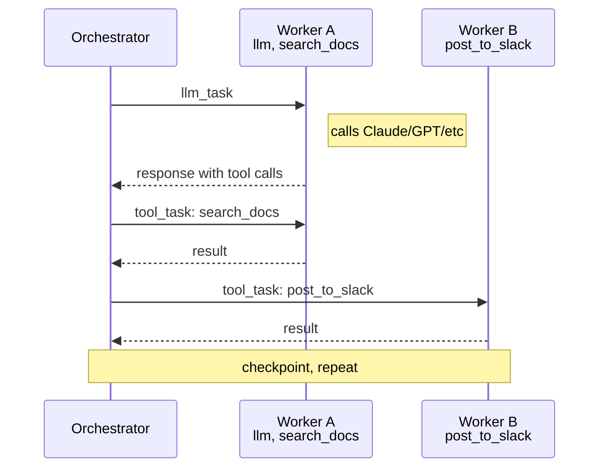

<p align="center">
  
</p>

<h1 align="center">Norns</h1>

<p align="center">
  <a href="https://github.com/nornscode/norns/actions/workflows/ci.yml"></a>
  <a href="LICENSE"></a>
  <a href="https://elixir-lang.org/"></a>
</p>

<p align="center">Agents that work while you're away.</p>

Norns runs agents that are on their own for days at a time. The run is backed by durable storage, not a process, so a deploy or a crash doesn't end it.

I have a steward agent that runs every weekday morning. It reads the open issues across a few repositories, decides what is worth doing, and asks me in Slack before it starts. The run parks on that question for as long as I take to answer. When I approve, it hands the job to a coding agent and waits. When the PR is up, the steward posts the link and the run ends.

That is the shape of thing Norns is for: a run that waits for a person, hands work to another agent, and keeps going regardless of what happens to the processes underneath it.

https://github.com/user-attachments/assets/b300b164-dc0c-44ea-a794-1de00b4f01a7

<p align="center"><sub>An agent calls <code>wait</code> (10s), then <code>say_hello</code>. I kill the worker twice mid-run. Each time a new worker connects and carries the run on from the event log. It resumes rather than restarting: steps that already finished are not run again.</sub></p>

## Get started

```bash
brew install nornscode/tap/nornsctl
nornsctl dev
nornsctl new my-agent
cd my-agent
uv sync
uv run my-agent-worker
```

That gives you a Norns server and a worker connected to it. The [hello agent](https://github.com/nornscode/norns-hello-agent) walks through the rest.

## How it works

Norns is an orchestrator written in Elixir on the BEAM. It never calls a model and never runs a tool. Workers connect over WebSocket, register their tools, and hold the API keys.



Every LLM call, tool call and tool result is an event in a Postgres log. A worker that picks a run up after a crash replays the log to find out where things stand. The details are in [docs/architecture.md](docs/architecture.md).

## SDKs and examples

- [Python SDK](https://github.com/nornscode/norns-sdk-python) — `pip install norns-sdk` ([PyPI](https://pypi.org/project/norns-sdk/))
- [Elixir SDK](https://github.com/nornscode/norns-sdk-elixir) — `{:norns_sdk, "~> 0.1"}` ([Hex](https://hex.pm/packages/norns_sdk))
- [CLI (`nornsctl`)](https://github.com/nornscode/nornsctl)
- [Hello example](https://github.com/nornscode/norns-hello-agent)
- [Mimir](https://github.com/nornscode/norns-mimir-agent) — a Slack knowledge bot, and the steward described above
- [Sleipnir](https://github.com/nornscode/sleipnir) — the coding agent the steward hands off to

## Status

Norns is v0.x. I run Mimir and the steward on it and it holds up, but the APIs are still moving. Breaking changes get called out in release notes, so pin versions. Hit a bug or some jank? [Open an issue](https://github.com/nornscode/norns/issues).

Where it's going, and why some things aren't being built, is in [docs/roadmap.md](docs/roadmap.md) and [docs/decision-log.md](docs/decision-log.md).

## License

MIT
