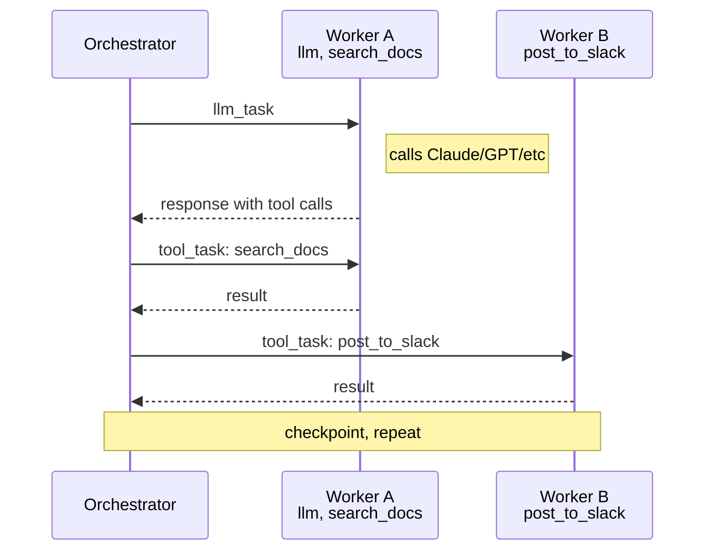

<p align="center">
  
</p>

<h1 align="center">Norns</h1>

<p align="center">
  <a href="https://github.com/nornscode/norns/actions/workflows/ci.yml"></a>
  <a href="LICENSE"></a>
  <a href="https://elixir-lang.org/"></a>
</p>

<p align="center">Agents that work while you're away.</p>

Norns runs agents that are on their own for days. The run lives in Postgres rather than in a process, so losing the process costs you nothing.

The one I run every weekday morning goes like this. A cron trigger starts the steward. It reads the open issues and recent commits across a few repos, picks something worth doing, and calls `ask_human` with a one-line proposal. The run parks; no process is waiting on it. A couple of hours later I see the question in Slack and reply "go". The run wakes up, calls `launch_agent`, and a coding agent picks the job up on a worker that has the repo checked out. When the coder opens a PR, the steward posts the link and finishes. Deploy Norns while the question is waiting, restart every worker, and the reply still lands on the right run.

- **A deploy or an eviction doesn't kill the run.** The next worker to connect replays the event log and continues from the last finished step. Tools that already ran are skipped on replay.
- **A coding agent gets a machine of its own.** A [gard](docs/gards.md) pins a run's tool calls to one worker, so `read_file` and `bash` land on the same checkout every time.
- **Agents are configuration.** Workers bring tools; an agent is a prompt, a model, a tool allowlist and a trigger. Once a Slack worker and a database worker are running, a new agent is an API call.

https://github.com/user-attachments/assets/b300b164-dc0c-44ea-a794-1de00b4f01a7

<p align="center"><sub>An agent calls <code>wait</code> (10s), then <code>say_hello</code>. I kill the worker twice mid-run. Each time a new worker connects and carries the run on from the event log. It resumes rather than restarting: steps that already finished are not run again.</sub></p>

## Get started

```bash
brew install nornscode/tap/nornsctl
nornsctl dev
nornsctl new my-agent
cd my-agent
uv sync
uv run my-agent-worker
```

That gives you a Norns server and a worker connected to it. The [hello agent](https://github.com/nornscode/norns-hello-agent) walks through the rest.

## How it works

Norns is an orchestrator written in Elixir on the BEAM. It never calls a model and never runs a tool. Workers connect over WebSocket, register their tools, and hold the API keys. The agent sees the union of every tool a connected worker registered, and the orchestrator routes each call to a worker that has it. If a worker dies mid-task, the task goes back in the queue.



Every LLM call, tool call and tool result is an event in a Postgres log. The log is the run: a worker that picks a run up after a crash replays it to find out where things stand. Postgres is the only thing you run besides Norns. Idempotency, error classification and the rest are in [docs/architecture.md](docs/architecture.md).

## SDKs and examples

- [Python SDK](https://github.com/nornscode/norns-sdk-python) — `pip install norns-sdk` ([PyPI](https://pypi.org/project/norns-sdk/))
- [Elixir SDK](https://github.com/nornscode/norns-sdk-elixir) — `{:norns_sdk, "~> 0.1"}` ([Hex](https://hex.pm/packages/norns_sdk))
- [CLI (`nornsctl`)](https://github.com/nornscode/nornsctl)
- [Hello example](https://github.com/nornscode/norns-hello-agent)
- [Mimir](https://github.com/nornscode/norns-mimir-agent) — a Slack knowledge bot, and the steward from the top of this page
- [Sleipnir](https://github.com/nornscode/sleipnir) — a coding worker; the agent the steward hands off to

## Status

Norns is v0.x. I run Mimir and the steward on it and it holds up, but the APIs are still moving. Breaking changes get called out in release notes, so pin versions. Hit a bug or some jank? [Open an issue](https://github.com/nornscode/norns/issues).

Where it's going, and why some things aren't being built, is in [docs/roadmap.md](docs/roadmap.md) and [docs/decision-log.md](docs/decision-log.md).

## License

MIT
