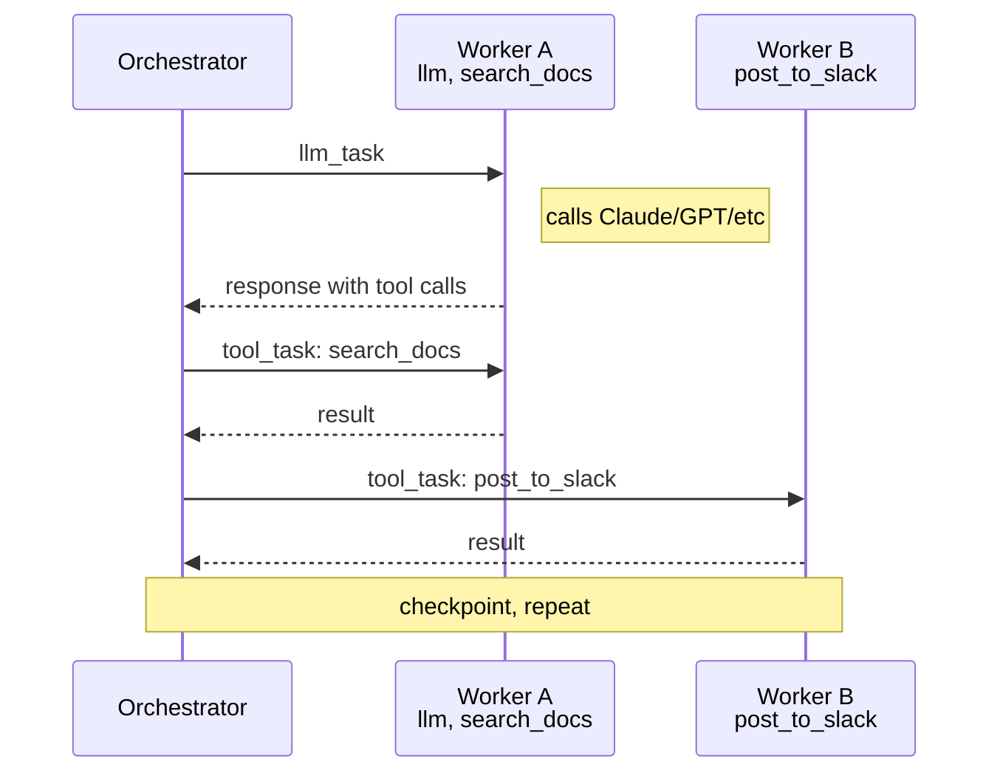

<p align="center">
  
</p>

<h1 align="center">Norns</h1>

<p align="center">
  <a href="https://github.com/nornscode/norns/actions/workflows/ci.yml"></a>
  <a href="LICENSE"></a>
  <a href="https://elixir-lang.org/"></a>
</p>

<p align="center">Agents that work while you're away.</p>

Norns runs agents that are on their own for days at a time. They start on a schedule or a webhook, ask you in Slack when they need a decision, hand jobs to other agents on their own machines, and keep going through deploys, crashes and weekends. The run lives in Postgres, not in a process, so nothing you do to the process can lose it.

Here is one that runs on Norns every weekday morning:

1. **07:00** — a cron trigger starts the steward. It reads the open issues and recent commits across a few repos and decides what's worth doing today.
2. **07:03** — it calls `ask_human` with a one-line proposal. The run parks. No process is waiting on it.
3. **09:40** — you see the question in Slack over coffee and reply "go". The run wakes up.
4. **09:41** — the steward calls `launch_agent` and a coding agent picks up the job on a worker that has the repo checked out. The steward waits on the child.
5. **10:15** — the coder opens a PR. The steward posts the link and finishes.

Between 07:03 and 09:40 the steward was two rows in a database. Deploy Norns in that window, restart every worker, and at 09:40 the reply still lands on the right run. Every step along the way is in the event log, so when you want to know why it chose that issue, the answer is there.

## What you get

- **Agents that wait.** `ask_human` parks a run until someone answers, for as long as that takes. `wait` sleeps without holding a process open. Replies come in through the API, so you can bridge them from Slack, email or a form.
- **Agents that delegate.** `launch_agent` starts a child run and waits for the result. Parent and child are linked in the log, and a parent that crashes mid-wait reattaches to its child instead of launching a second one.
- **Agents that start themselves.** Cron triggers and inbound webhooks start runs. Nothing has to be awake to kick them off.
- **Agents with a machine of their own.** A [gard](docs/gards.md) pins a run's tool calls to one worker, so a coding agent's `read_file` and `bash` land on the same checkout every time.
- **Agents that survive.** Kill the worker, kill Norns, redeploy. The next worker to connect replays the event log and carries on from the last finished step. Tools that already ran are not run again.
- **Agents that are just configuration.** A worker brings tools; an agent is a prompt, a model, a tool allowlist and a trigger. Once your Slack worker and your database worker are running, a new agent is an API call, not a deploy.

<details>
<summary>Watch a run survive its worker being killed, twice</summary>

https://github.com/user-attachments/assets/b300b164-dc0c-44ea-a794-1de00b4f01a7

An agent calls `wait` (10s), then `say_hello`. I kill the worker twice mid-run. Each time a new worker connects and carries the run on from the event log. Steps that already finished are not run again.

</details>

## Get started

```bash
brew install nornscode/tap/nornsctl
nornsctl dev
nornsctl new my-agent
cd my-agent
uv sync
uv run my-agent-worker
```

That gives you a Norns server and a worker connected to it. The [hello agent](https://github.com/nornscode/norns-hello-agent) walks through the rest.

## How it works

Norns is an orchestrator written in Elixir on the BEAM. It never calls a model and never runs a tool. It holds the state of every run, decides what happens next, and hands the work to workers.

Workers connect over WebSocket, register their tools, and hold the API keys. There's usually more than one. Each worker brings its own set of tools (a Slack worker, a database worker, one that wraps your internal API), and the agent sees the union of everything connected. The orchestrator routes each tool call to a worker that registered that tool. If no worker is connected, tasks queue until one shows up. If a worker dies mid-task, the orchestrator notices and puts the task back in the queue.



Every LLM call, tool call and tool result is an event in a Postgres log. That log is the run. A worker picking up a run after a crash replays it to find out where things stand.

Side-effecting tools get a deterministic idempotency key derived from the run ID, step number and tool call ID. On replay, if a result already exists for that key, the tool is skipped. That's what keeps a resumed run from sending the same email twice.

Errors get classified, because retrying everything is as wrong as retrying nothing:

- Transient failures (timeouts, worker disconnects, upstream outages) get a few retries with exponential backoff.
- Rate limits get patient retries with linear backoff. The dependency is fine, you just have to wait.
- Validation and policy errors are terminal. Retrying won't fix a bad input.

Postgres is the only thing you run besides Norns. Background jobs go through Oban on the same database, and there is no Redis or message broker. The wire format is provider-neutral, so workers can use whichever model they like, and your keys never leave them.

## SDKs and examples

- [Python SDK](https://github.com/nornscode/norns-sdk-python) — `pip install norns-sdk` ([PyPI](https://pypi.org/project/norns-sdk/))
- [Elixir SDK](https://github.com/nornscode/norns-sdk-elixir) — `{:norns_sdk, "~> 0.1"}` ([Hex](https://hex.pm/packages/norns_sdk))
- [CLI (`nornsctl`)](https://github.com/nornscode/nornsctl)
- [Hello example](https://github.com/nornscode/norns-hello-agent)
- [Mimir](https://github.com/nornscode/norns-mimir-agent) — a Slack knowledge bot, and the steward loop from the top of this page
- [Sleipnir](https://github.com/nornscode/sleipnir) — a coding worker; the agent the steward hands off to

### Worker

```python
from norns import Norns, Agent, tool

@tool
def search_docs(query: str) -> str:
    return "..."

agent = Agent(
    name="support-bot",
    model="claude-sonnet-5",
    system_prompt="You are a support assistant.",
    tools=[search_docs],
)

norns = Norns("http://localhost:4000", api_key="nrn_...")
norns.run(agent)
```

### Client

```python
from norns import NornsClient

client = NornsClient("http://localhost:4000", api_key="nrn_...")
result = client.send_message("support-bot", "Where is my order?", wait=True)
print(result.output)
```

## Status

Norns is v0.x. I run Mimir and the steward loop on it and it holds up, but the APIs are still moving. Breaking changes get called out in release notes, so pin versions. Hit a bug or some jank? [Open an issue](https://github.com/nornscode/norns/issues).

The longer plan is in [docs/roadmap.md](docs/roadmap.md) and [docs/decision-log.md](docs/decision-log.md).

## License

MIT
